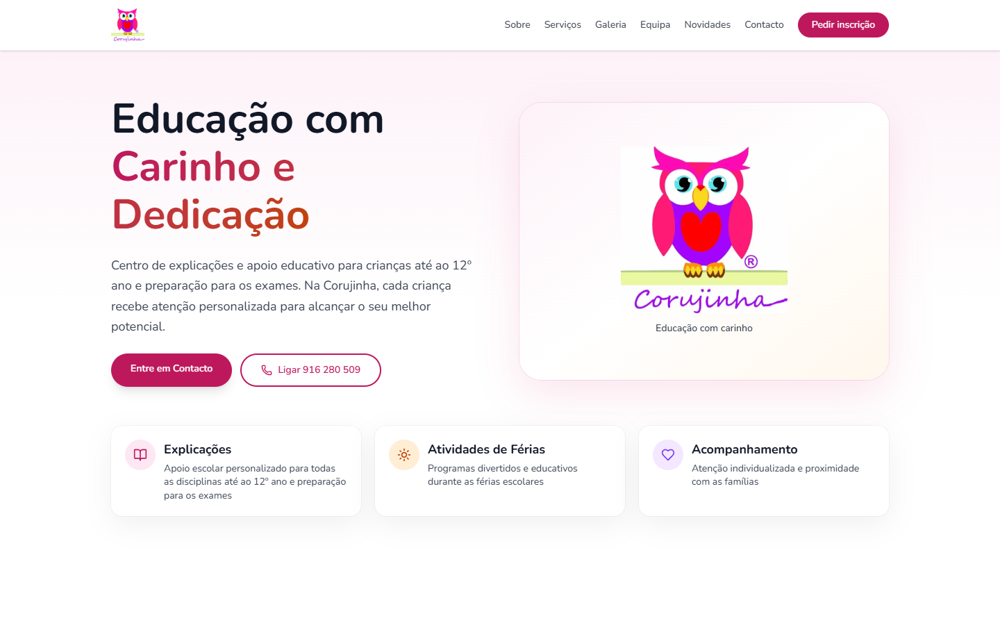
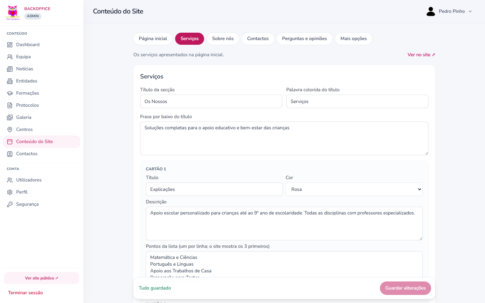

# corujinha-web

[](https://github.com/PedroPinho17/corujinha-web/actions/workflows/ci.yml)

Website and CMS for **Corujinha**, a tutoring and school support centre in Portugal. It replaces a legacy Laravel site.

> Versão em português: [README.pt.md](README.pt.md) · Architecture decisions: [docs/DECISIONS.md](docs/DECISIONS.md)

**Status:** ready for deployment, not yet live.

| Public site | Mobile | Backoffice |
|---|---|---|
|  |  |  |

## Highlights

- **Security:** CSP with per-request nonces, closed sign-up, passkeys, role-based access and atomic rate limits.
- **Privacy:** consent tracking, GDPR export and erasure restricted to admins, and automatic anonymisation.
- **Resilience:** the site, login and contact form keep working if Redis goes down.
- **Performance:** optimised images and two cache layers that are refreshed as soon as content changes.
- **Testing:** unit tests on the API, and Playwright for smoke, CSP, accessibility (axe/WCAG) and responsive layout.
- **Operations:** Docker, CI with a full-stack smoke test, and a production runbook.

## Stack

| Area | Technology |
|------|------------|
| Web | Next.js 15, React 19, Tailwind CSS, shadcn/ui |
| API | NestJS, Better Auth, BullMQ |
| Data | PostgreSQL, TypeORM, Redis |
| Storage and email | S3 / Cloudflare R2, SMTP / Resend |
| Tooling | pnpm, Turborepo, Vitest, Playwright, GitHub Actions, Docker, Coolify, Sentry |

## Project structure

```
apps/web/           Next.js: public site and /admin
apps/api/           NestJS: auth, CMS API, queues, media, GDPR
packages/database/  TypeORM entities, migrations and seed
packages/shared/    shared types and default site content
e2e/                Playwright suites
docker/             entrypoints and deployment guide
docs/               runbook and architecture decisions
```

## Getting started

Requirements: Node 22, pnpm 9, Docker, and PostgreSQL on port 5432.

```bash
cp .env.example .env
# Set ADMIN_PASSWORD (12+ characters), BETTER_AUTH_SECRET (32+) and the Garage keys (see docs/RUNBOOK.md)

psql -U postgres -c "CREATE ROLE corujinha LOGIN PASSWORD 'corujinha'"
psql -U postgres -c "CREATE DATABASE corujinha OWNER corujinha"

pnpm install
pnpm docker:up                          # Redis, Garage (S3) and Mailpit
pnpm --filter @corujinha/shared build
pnpm --filter @corujinha/database build
pnpm db:deploy                          # migrations
pnpm db:seed                            # admin account and initial content
pnpm dev
```

The role and database must match `DATABASE_URL` in `.env`. The first admin login requires a password change.

| Service | URL |
|---------|-----|
| Site | http://localhost:3000 |
| Backoffice | http://localhost:3000/admin/login |
| API health | http://localhost:3001/api/health |
| Mailpit (test email) | http://localhost:8026 |

### Local development notes

- Web and API both read the root `.env`. Variables already set in the environment take priority.
- `pnpm dev` compiles each page on its first visit, so that first load is slow.
- Images are not optimised locally, because Node cannot resolve the local `*.garage.localhost` media host.

## Testing

```bash
pnpm test                               # API unit tests with coverage
pnpm typecheck
pnpm lint

pnpm exec playwright install chromium   # once, and after updating Playwright
pnpm test:e2e                           # needs the site and API running
```

The `csp` suite expects a build with no images served over plain HTTP, as production blocks them.

## Deployment

See the [Coolify guide](docker/COOLIFY.md) and the [go-live checklist](docs/RUNBOOK.md).

- Traffic flows from Traefik to the web app, which forwards `/api/*` to the API. Only the web app is exposed.
- Migrations run automatically when the API container starts.
- `REVALIDATE_SECRET` must be the same on the web and API services.
- Check a live deployment with `pnpm verify:production -- https://YOUR_DOMAIN`.

## License

Corujinha project. This repository does not include a licence for reuse.
